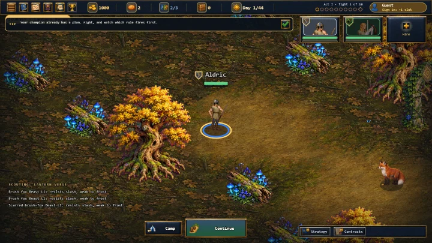
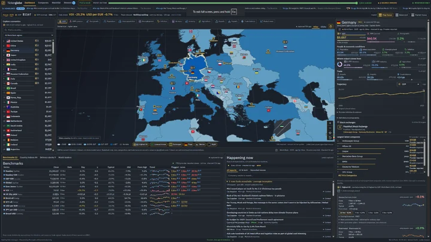
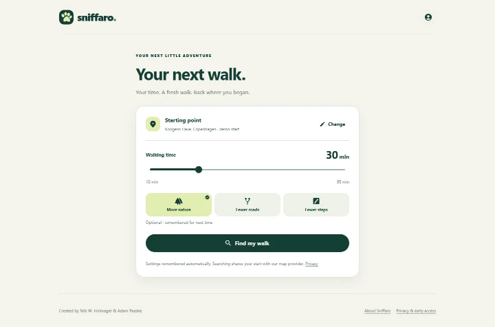

I build software people can use, and research how AI systems can do work people can take responsibility for.

Senior Engineer at WSAudiology · Copenhagen, Denmark. The projects and research below are my independent work.

**[Website](https://nilsholmager.com/)** · **[Research & publications](https://nilsholmager.com/research/)** · **[ORCID](https://orcid.org/0009-0009-7157-9084)**

## The connected research stack

1. **[Augmented Individual Intelligence (AII)](https://doi.org/10.5281/zenodo.18417872)** - A framework for continuous human and AI cognitive partnership.
2. **[Principles of Earned Autonomy (PEA)](https://github.com/ntholm86/principles-of-earned-autonomy)** - A governance framework for justified delegation to autonomous agents.
3. **[Agent Cognition Skills (ACS)](https://github.com/ntholm86/agent-cognition-skills)** - General-purpose skills for agent intent, goal, improvement, recording and learning.
4. **[Agent Context Memory (ACM)](https://github.com/ntholm86/agent-context-memory)** - A specification for persistent, governed context across agents and sessions.
5. **[AI Steward](https://github.com/ntholm86/ai-steward)** - An autonomous code-improvement loop with operator-held direction and verification.
6. **[Agent Evidence Proxy (AEP)](https://github.com/ntholm86/agent-evidence-proxy)** - A fail-closed proxy for independently captured, hash-chained LLM evidence.

These are connected contributions, not interchangeable names: AII defines the human-AI relationship, PEA governs delegation, ACS supplies cognition, ACM supplies continuity, AI Steward applies the loop to code, and AEP captures independent evidence.

The framework and skills remain research proposals and host/model-dependent implementations. Claims are bounded by their published evidence.

<strong>Inspect the evidence and limitations</strong>

[The first reproducible pilot](https://nilsholmager.com/research/accountable-agent-pilot/) produced four functional passes, but neither PEA-labeled session applied the required trace workflow. The intended comparison is inconclusive, not a demonstrated PEA advantage.

Interested in trying or challenging the approach? **[Start with the open pilot](https://github.com/ntholm86/agent-cognition-skills/tree/main/experiments/accountable-agent-pilot)**. Useful failures are welcome.

## Other engineering

- **[Vectorium Engine](https://github.com/ntholm86/VectoriumEngine)** - Data-oriented rendering in TypeScript and WebGL.

## Ideas made tangible

- **[Fantasy Combat Manager](https://fantasycombatmanager.com/)** - Browser strategy game. [Concept to public launch: under 2 weeks.](https://nilsholmager.com/work/fantasy-combat-manager/)
- **[TickerGlobe](https://tickerglobe.com/)** - Investment workspace; login required. [Idea to private launch: under 3 days.](https://nilsholmager.com/work/tickerglobe/)
- **[Sniffaro](https://sniffaro.com/)** - Time-based dog-walk planner, co-created with Adam Paaske. [Idea to public beta: 2h 17m.](https://nilsholmager.com/work/sniffaro/)

Recorded launch milestones, not coding-hour estimates or finished-development claims. Linked overviews explain the evidence and limits; these are not controlled measurements of PEA's effect.
