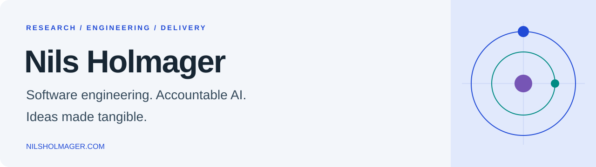

I build software people can use, and research how AI systems can do work people can take responsibility for.

Senior Engineer at WSAudiology · Copenhagen, Denmark. The projects and research below are my independent work.

**[Website](https://nilsholmager.com/)** · **[Research & publications](https://nilsholmager.com/research/)** · **[ORCID](https://orcid.org/0009-0009-7157-9084)**

## Research → tools → real work

| Work | The question it addresses |
| :--- | :--- |
| **[Principles of Earned Autonomy](https://github.com/ntholm86/principles-of-earned-autonomy)** | What makes delegation to an AI agent justified? A proposed framework connecting operator intent, observable autonomy and independent challenge. |
| **[PEA Skills Suite](https://github.com/ntholm86/principles-of-earned-autonomy-skills-suite)** | How can those principles become a working practice? Open agent skills for intent, improvement, verification and retained decision records. |
| **[Agent Context Memory](https://github.com/ntholm86/agent-context-memory)** | How should agents carry context across sessions without losing human authority? A governance-first memory specification. |

These are connected contributions, not interchangeable names. The framework is a proposal; the skills are experimental and host/model-dependent.

**Inspect the evidence:** [the first reproducible pilot](https://nilsholmager.com/research/accountable-agent-pilot/) produced four functional passes, but neither PEA-labeled session applied the required trace workflow. The intended comparison is inconclusive—not a demonstrated PEA advantage.

## Ideas made tangible

<table>
<tr>
<td width="33%" valign="top">

 <strong><a href="https://fantasycombatmanager.com/">Fantasy Combat Manager</a></strong>
 Browser strategy game.
 <a href="https://nilsholmager.com/work/fantasy-combat-manager/">Concept → public launch: under 2 weeks</a>
</td>
<td width="33%" valign="top">

 <strong><a href="https://tickerglobe.com/">TickerGlobe</a></strong>
 Investment workspace. Login required.
 <a href="https://nilsholmager.com/work/tickerglobe/">Idea → private launch: under 3 days</a>
</td>
<td width="33%" valign="top">

 <strong><a href="https://sniffaro.com/">Sniffaro</a></strong>
 Time-based dog-walk planner. Co-created with Adam Paaske.
 <a href="https://nilsholmager.com/work/sniffaro/">Idea → public beta: 2h 17m</a>
</td>
</tr>
</table>

Recorded launch milestones, not uninterrupted coding hours or claims that development stopped. The linked overviews explain the evidence and limits; they do not establish that PEA caused the delivery speed.

## Under the hood

- **[LLM Harness Proxy](https://github.com/ntholm86/llm-harness-proxy)** — Rust proxy for independently captured, hash-chained LLM interaction records.
- **[AI Steward](https://github.com/ntholm86/ai-steward)** — an autonomous code-improvement loop with harness-captured evidence and operator-held direction.
- **[Vectorium Engine](https://github.com/ntholm86/VectoriumEngine)** — data-oriented rendering in TypeScript and WebGL.

Interested in trying or challenging the approach? **[Start with the open pilot](https://github.com/ntholm86/principles-of-earned-autonomy-skills-suite/tree/main/experiments/accountable-agent-pilot)**—useful failures are welcome.
