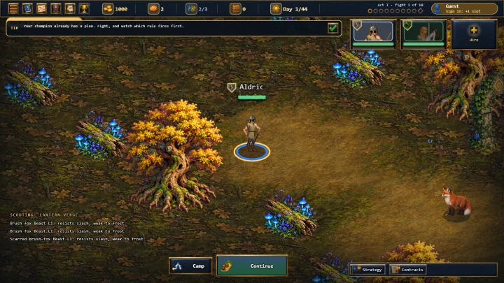
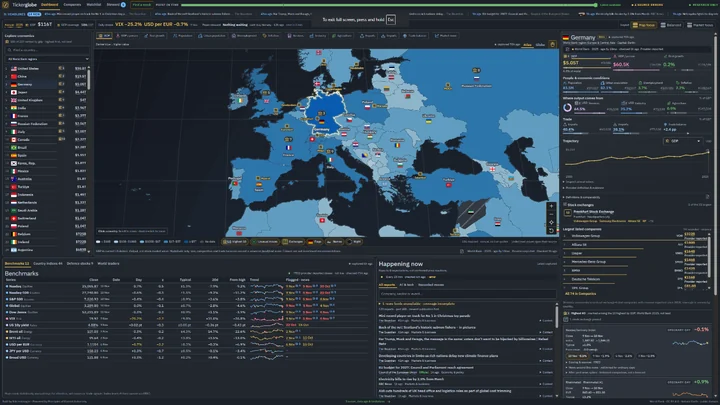
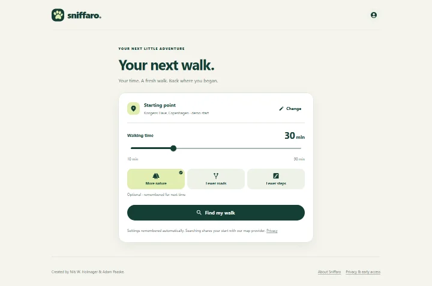

I build software people can use, and research how AI systems can do work people can take responsibility for.

Senior Engineer at WSAudiology · Copenhagen, Denmark. The projects and research below are my independent work.

**[Website](https://nilsholmager.com/)** · **[Research & publications](https://nilsholmager.com/research/)** · **[ORCID](https://orcid.org/0009-0009-7157-9084)**

## Research → tools → real work

- **[Principles of Earned Autonomy](https://github.com/ntholm86/principles-of-earned-autonomy)** — What makes delegation to an AI agent justified? A proposed framework connecting operator intent, observable autonomy and independent challenge.
- **[PEA Skills Suite](https://github.com/ntholm86/principles-of-earned-autonomy-skills-suite)** — The working practice: open agent skills for intent, improvement, verification and retained decision records.
- **[Agent Context Memory](https://github.com/ntholm86/agent-context-memory)** — Persistent context across sessions, without losing human authority. A governance-first memory specification.

These are connected contributions, not interchangeable names. The framework is a proposal; the skills are experimental and host/model-dependent.

<strong>Inspect the evidence and limitations</strong>

[The first reproducible pilot](https://nilsholmager.com/research/accountable-agent-pilot/) produced four functional passes, but neither PEA-labeled session applied the required trace workflow. The intended comparison is inconclusive—not a demonstrated PEA advantage.

## Ideas made tangible

- **[Fantasy Combat Manager](https://fantasycombatmanager.com/)** — Browser strategy game. [Concept → public launch: under 2 weeks.](https://nilsholmager.com/work/fantasy-combat-manager/)
- **[TickerGlobe](https://tickerglobe.com/)** — Investment workspace; login required. [Idea → private launch: under 3 days.](https://nilsholmager.com/work/tickerglobe/)
- **[Sniffaro](https://sniffaro.com/)** — Time-based dog-walk planner, co-created with Adam Paaske. [Idea → public beta: 2h 17m.](https://nilsholmager.com/work/sniffaro/)

Recorded launch milestones, not coding-hour estimates or finished-development claims. Linked overviews explain the evidence and limits; these are not controlled measurements of PEA's effect.

## Under the hood

- **[LLM Harness Proxy](https://github.com/ntholm86/llm-harness-proxy)** — Rust proxy for independently captured, hash-chained LLM interaction records.
- **[AI Steward](https://github.com/ntholm86/ai-steward)** — an autonomous code-improvement loop with harness-captured evidence and operator-held direction.
- **[Vectorium Engine](https://github.com/ntholm86/VectoriumEngine)** — data-oriented rendering in TypeScript and WebGL.

Interested in trying or challenging the approach? **[Start with the open pilot](https://github.com/ntholm86/principles-of-earned-autonomy-skills-suite/tree/main/experiments/accountable-agent-pilot)**—useful failures are welcome.
